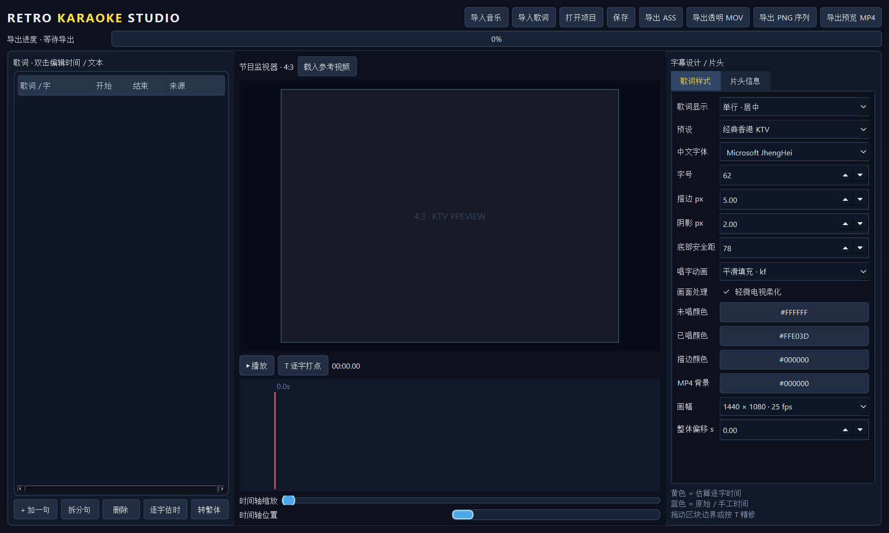

<h1 align="center">Retro Karaoke Studio</h1>

把音乐与歌词做成 80–90 年代香港 KTV 风格的逐字变色字幕。 本地运行 · 可视化校时 · 透明导出 · Premiere Pro 工作流

  
  
  
  
  

<a href="https://github.com/LLLimit/RetroKaraokeStudio/releases/latest"><strong>下载 Windows 版</strong></a> · <a href="#启动">启动</a> · <a href="#工作流">使用方法</a> · <a href="#premiere-pro-2025">Premiere Pro</a> · <a href="TEST_REPORT.md">测试报告</a>

本地运行的 Windows 香港 KTV 歌词编辑器。输出包含 ASS Karaoke、透明 ProRes 4444 MOV、透明 PNG 序列与带音频的 MP4 预览。普通 LRC/TXT 只有逐句时间，逐字时间会明确标记为估算，之后可在波形上修正。

> **配套歌词识别工具：**[AudioToLyrics](https://github.com/huqiu0313/AudioToLyrics) 是 **huqiu0313 的独立项目**，不是 Retro Karaoke Studio 开发的功能。组合包附带其 v5.2.0 官方原版安装程序，供首次使用时安装；来源、校验值与许可说明见 [THIRD_PARTY_NOTICES.md](THIRD_PARTY_NOTICES.md)。

## 功能亮点

| 功能 | 说明 |
| --- | --- |
| 逐字歌词 | 导入 LRC、增强 LRC、KRC、ASS、TXT；支持手动打点、拖动边界与撤销 |
| 港式字幕 | 4:3 安全区、黄白逐字填充、电视柔化及多种预设；支持双列交替显示 |
| 片头信息 | 从本地音频与歌词标签读取歌名、原唱等信息，缺失项可手动编辑 |
| 本地繁体转换 | OpenCC 转香港繁体，尽量保留现有逐字时间 |
| 透明导出 | ASS、ProRes 4444 MOV、PNG 序列；另有 MP4 快速预览 |
| 项目恢复 | `.rks.json` 保存、自动保存及异常恢复 |
| 配套识别 | 从软件内启动 AudioToLyrics，生成 LRC／增强 LRC／KRC 后再导入编辑 |

## 启动

- 从 [Releases](https://github.com/LLLimit/RetroKaraokeStudio/releases/latest) 下载 Windows ZIP，解压后运行 `RetroKaraokeStudio.exe`。请保留整个文件夹，不能只复制 EXE。
- 源码运行：在 PowerShell 执行 `powershell -ExecutionPolicy Bypass -File .\run.ps1`。
- 重新打包：执行 `powershell -ExecutionPolicy Bypass -File .\build.ps1`。打包脚本会把当前 PATH 中的 `ffmpeg.exe` 和 `ffprobe.exe` 放入 EXE 文件夹，因此打包后离线可用。
- 如果要制作包含 AudioToLyrics 官方安装程序的组合包，先从[上游 v5.2.0 发布页](https://github.com/huqiu0313/AudioToLyrics/releases/tag/v5.2.0)下载 `AudioToLyrics-v5.2.0-setup.exe`，放入 `third_party/`，再运行 `build.ps1`。脚本会核对 SHA-256 后复制到 `Tools/`；源码仓库不存放第三方安装包。

## 搭配 AudioToLyrics

1. 在 Retro Karaoke Studio 导入音乐，点击顶部 **「识别歌词」**。已安装 AudioToLyrics 时直接启动；首次使用组合包时，会提示启动随包附带的上游官方安装程序。
2. 点击启动时，当前音乐的完整路径会复制到剪贴板。请在 AudioToLyrics 的“添加文件”或“手动搜索”中选择这首歌。上游程序没有可用的命令行文件导入接口，因此不会自动开始识别。
3. 在 AudioToLyrics 中生成 LRC、增强 LRC 或 KRC 文件；回到 Retro Karaoke Studio 点击 **「导入歌词」**，选择生成的文件，再检查时间和逐字效果。

Retro Karaoke Studio 的编辑与导出仍可离线运行；AudioToLyrics 的在线歌词搜索、可选模型下载等功能需要网络，具体行为由[上游项目](https://github.com/huqiu0313/AudioToLyrics)提供。

## 工作流

1. 点击“导入音乐”，支持 WAV、MP3、FLAC、M4A、AAC、OGG。软件根据音频时长设置时间轴。
2. 点击“导入歌词”，支持 LRC、增强 LRC、KRC、ASS、TXT。普通 LRC/TXT 的逐字时间标“估算”；增强 LRC/KRC/ASS 原始 Karaoke 时间标“精确”。
3. 左栏双击编辑歌词、句开始/结束、字开始/结束；选中字后点“拆分句”可在该字前分行；底部拖动字块边界微调。选中字，播放时按 **T** 给该字打点，并自动结束上一个字。
4. 空格播放/暂停；拖动时间尺定位；滑块缩放；Ctrl+Z/Ctrl+Y 撤销/重做；右栏选择样式、逐字动画、轻微柔化和 1440×1080/25fps 或 1920×1080/30fps。
5. 可载入参考视频；它只作为监视器背景，不会写入透明导出。右栏可设置 MP4 预览背景色。点击“导出 ASS”“导出透明 MOV”“导出 PNG 序列”或“导出预览 MP4”。
6. Ctrl+S 保存 `.rks.json`。每 30 秒自动保存到 `%LOCALAPPDATA%\RetroKaraokeStudio\autosave.rks.json`，下次启动自动恢复。

### 新版片头与双列歌词

- 右栏“歌词样式 > 歌词显示”可选单行居中、底部双行交替、双列左上当前、双列右下当前。双列模式会提前显示下一句；它开始时移到当前歌词位置，并按逐字时间变色。
- 右栏“片头信息”可开关复古歌名与制作人员卡片，修改显示秒数，并编辑歌名、原唱、作词、作曲、编曲、MV 导演。导入音乐或歌词后会默认读取本地标签；手动填写的非空字段在重新解析时保留。
- `samples/stagger_demo_alpha.mov` 是新片头与双列歌词示例，可直接放到 Premiere 的视频轨道上方，00:00:00:00 对齐音频。
- 自动解析仅检查音频嵌入标签、LRC/KRC 标签、ASS 标题和文件名，不会听歌推断作者、编曲或导演。`artist`/`ar` 仅作为“原唱”候选，需核对；未找到的字段留空。

### 时间轴移动与繁体转换

- 放大时间轴后，拖动下方“时间轴位置”滚动条，或在波形区域滚动鼠标滚轮，即可移动到歌曲中后段。点击时间尺可跳转；播放头走出当前范围时会自动跟随。
- 导入简体歌词后，点击左栏“转繁体”，会在本地用 OpenCC 转成香港繁体。逐字时间和 `\k` / `\kf` / `\ko` 动画类型会保留；Ctrl+Z 可撤销。转换的是歌词文字，所选字体仍需包含对应繁体字形。
- 顶部“导出透明 MOV”“导出 PNG 序列”“导出预览 MP4”会显示导出进度。进度按 FFmpeg 已处理的时间计算；MOV 渲染后还会检查透明通道，完成或失败均会显示状态。

## Premiere Pro 2025

导入 `samples/demo_alpha.mov` 或你导出的 MOV，把它放在视频轨道上方，并从 **00:00:00:00** 对齐音乐和画面。示例 MOV 自带 PCM 音频；如果时间线上也放了原音乐，请将其中一条音轨静音，避免叠加。序列建议 1440×1080、25fps、方形像素；也可选择 1920×1080、30fps 预设。下方视频应透过歌词外的透明区域显示。如果 Premiere 对 ProRes Alpha 的解释不同，检查素材“修改 > 解释素材”中的 Alpha 设置；若仍异常，改用 PNG 序列并启用图像序列导入。最终请用你自己的 Premiere 安装手动核对导入、Alpha、字形和音画同步。

## 格式与技术说明

- 逐字变色由 ASS `\kf` 渲染；导入 ASS 时会保留每个字的 `\k`、`\kf`、`\ko` 类型。没有原始逐字时间时软件只做估算，不声称自动听懂歌曲。
- KRC 支持 `krc1` XOR+zlib 格式和未压缩文本格式，仅解析用户合法取得的歌词。部分变体可能不兼容。
- 实际导出使用 FFmpeg 的 libass 滤镜在透明 RGBA 画布上渲染，ProRes 4444 的像素格式为带 Alpha 的 `yuva444p*`。本机 FFprobe 和解码像素检查见 `TEST_REPORT.md`。
- 透明 MOV 是独立歌词层；参考背景视频不会被打进 MOV。MP4 预览是黑色背景。
- 系统字体不会随项目嵌入。迁移到别的电脑前请确认同名字体存在；缺字体时 FFmpeg/libass 会回退，效果可能变化。
- 当前没有语音识别或自动精确对齐，精确逐字时间应从增强 LRC/KRC/ASS 导入，或在波形上手动修正。

## 项目结构

`rks/model.py` 时间轴与保存；`rks/importers.py` 歌词导入；`rks/ass.py` ASS 生成；`rks/export.py` 视频导出和 Alpha 验证；`rks/gui.py` 编辑器；`samples/` 测试音频、歌词、项目和透明样片；`tests/` 自动化测试。

## 许可证

本项目源码采用 [MIT](LICENSE) 许可证，不使用付费 API。PySide6、FFmpeg/libass、PyInstaller、OpenCC 和 Python 各有自己的许可证；分发时须遵守各自条款，详见 [LICENSES.md](LICENSES.md)。Windows 包内的 Gyan FFmpeg 为 GPLv3 静态构建，由本工具通过独立子进程调用。AudioToLyrics 的来源和许可单独列于 [THIRD_PARTY_NOTICES.md](THIRD_PARTY_NOTICES.md)。
